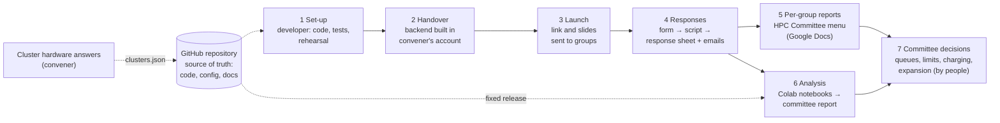

# HPC Workload Questionnaire: guide for the convener

For the convener of the HPC Users' Committee, who owns the questionnaire's responses.
Form version 2.7.2, analysis release `v3-2026-11-23b` (November 2026).

- **Part 1** says what the system is made of, how the responses are protected, and what could go wrong.
- **Part 2** describes the whole pipeline, from set-up to the committee's decisions, and how to run each part.

---

# Part 1. The system, data protection and risks

## 1.1 The pipeline at a glance

Research groups fill in a web form. Their answers go into a Google Sheet in the convener's institute
Google account. A script attached to that sheet receives the answers and sends confirmations. A notebook
in Google Colab turns the sheet into the committee report. All code lives in one public repository.

| Part | App | What it does | Where it resides | Owned by |
|---|---|---|---|---|
| Web form | Web page (React) on GitHub Pages | Respondents fill in and submit the questionnaire | <https://svaradh.github.io/hpc-questionnaire/> | Developer's GitHub account |
| Sign-in | Google sign-in ("Sign in with Google") | Confirms the respondent has an @iiserb.ac.in account | Developer's Google Cloud project (holds no data) | Developer |
| Backend | Google Apps Script, attached to the sheet | Receives submissions, writes them to the sheet, sends emails, adds the HPC Committee menu | Inside the response sheet | Convener |
| Response sheet | Google Sheets (14 tabs + Scenarios) | Stores every answer | Convener's Google Drive | Convener |
| Per-group reports | Google Docs | One group's answers, made on request | "HPC Committee Reports" folder, convener's Drive | Convener |
| Emails | Sent through the convener's account (send only) | Confirmation with a copy of the answers to the respondent and the PI; follow-ups | Recipients' inboxes; convener's Sent folder | Convener |
| Analysis | Google Colab notebooks (Python) | Builds the committee report from the sheet | Convener's Drive copy of the notebook; code fetched from a fixed release of the repository | Convener runs it |
| Source code and configuration | GitHub repository | Form, backend, analysis, cluster configuration, documentation | <https://github.com/svaradh/hpc-questionnaire> | Developer (public) |
| Respondent's draft | The respondent's browser | Keeps unfinished answers until submitted; offers a printable copy afterwards | That person's computer | Respondent |

## 1.2 How the data is protected

### A. Where the responses are, and who can see them

1. Every response is stored in **one Google Sheet in the convener's account**. Nobody else can open it
   until the convener shares it.
2. The reports folder and the script are in the same account, and equally private.
3. The developer has **no access** to the sheet, the folder or the script after the handover. The handover
   checks this and stops if it is not so.
4. The test backend used before the handover stays in the developer's account, **closed and empty**. The
   handover happens before the form is announced, so it never holds real responses.
5. A respondent's unfinished answers stay in their own browser until they submit.

### B. What the backend script can and cannot do

Google's permission screen describes access by kind of service ("all your spreadsheets"), because that is
the only way it can. What the script actually does was checked line by line
(`docs/permissions-audit.md` in the repository).

1. It opens **only** the response sheet and the reports folder, by their IDs. Only the convener can
   change those IDs.
2. It adds rows for each submission. It replaces a submission only when its own submitter or its PI edits
   it.
3. It creates a report document **only** when the convener asks for one, inside the reports folder.
4. It **sends** email only: a confirmation with a copy of the answers to the respondent and the PI, a
   follow-up the convener chooses to send, and one set-up email. It **cannot read, search or delete** mail.
5. It contacts one outside address: Google's own sign-in check.
6. It **never** shares, copies, lists, searches, bins or deletes any file. It never opens any other
   sheet, document or folder.

### C. Who can submit, and what they share

1. Only people signed in with a verified **@iiserb.ac.in** Google account can submit.
2. Signing in gives the form only the person's name and email address. It gets no access to their Drive,
   mail or anything else.
3. The PI's address must also be an @iiserb.ac.in address, so no email goes outside the institute.
4. One submission per PI address. Each row records who sent it.

### D. What leaves the sheet

1. **Confirmation emails** carry the group's own answers, to the person who submitted and the PI only.
2. **Per-group reports** (HPC Committee menu) contain one group's answers, with names, except the
   budget answers. They are shared only if the convener shares them.
3. **The committee report** (Colab) shows counts, totals and distributions, **no group names**. Budget
   answers (Section H) appear **only as totals**, as the form tells respondents.
4. **The triage notebook (06)** lists entries needing follow-up by submission ID and PI name. Only
   whoever runs it sees it.

### E. The analysis code

1. Notebooks run in the convener's own Colab session, from the convener's Drive copy.
2. They download the analysis code from a **fixed, tested release** of the repository (`REPO_REF`), not
   the latest version. New code reaches them only when the convener changes `REPO_REF`.
3. Each report states the release and its commit, so it can be traced and reproduced.
4. The code reads the response sheet, and adds one row to its Scenarios tab when a scenario is saved. It
   writes nothing else.

## 1.3 Risks, and what reduces them

1. **The convener's account is the only key.** Anyone who gets into it can read every response.
   *Reduce:* keep 2-step verification on; share the sheet with as few people as needed, with Viewer access.
2. **Accidental sharing.** An "Anyone with the link" setting would expose the sheet.
   *Reduce:* keep the sheet and folder Restricted, and add named people only.
3. **Binning the sheet.** The script keeps writing to a sheet in the Bin (seen in testing), so responses
   collect out of sight and are lost if the Bin is emptied.
   *Reduce:* never bin the sheet while the form is open; give it a distinctive name such as "… LIVE";
   restore it from Drive's Bin if it happens.
4. **Emails come from the convener's account.** Replies come to the convener, and copies sit in the Sent
   folder. *Reduce:* expected; filter them into a label if wished.
5. **The form's page is published from the developer's GitHub account.** The developer could change future
   versions of the page. *Reduce:* every change is public in the repository's history; the committee
   can ask for the repository to move to an institutional account.
6. **Colab's sign-in is broad.** During a session, the notebook could reach the convener's Drive.
   *Reduce:* the code is a fixed release that only reads the sheet and writes Scenarios rows; always work
   in your own Drive copy.
7. **Spurious submissions.** Any @iiserb.ac.in user can submit for a PI address.
   *Reduce:* one submission per PI; each row records the sender; the PI gets a copy and can object.
8. **The sign-in set-up is in the developer's Google Cloud project.** If it were deleted, sign-in would
   stop. *Reduce:* it holds no data; the developer keeps it until the exercise ends.
9. **Edits only from the same browser.** A respondent who changes computer cannot edit their submission.
   *Reduce:* they ask the committee; the convener corrects the sheet or clears the group's rows.
10. **Personal data.** Names and institute email addresses of respondents and PIs are stored.
    *Reduce:* they stay in the sheet and reports; the committee sets a retention period (section 2.8).

## 1.4 Frequently asked questions

1. **Can the developer see the responses?** No. After the handover only the convener's account can open
   the sheet, and the handover checks this.
2. **Why does Google's permission screen ask for so much?** Google names permissions by service, not by
   file. Section 1.2B lists what the script actually does.
3. **Can the script read my email?** No. It has "Send email as you" only.
4. **Does the committee see who answered what?** In the committee report, no: only counts and totals.
   Per-group reports and the triage list name groups, and are seen only if the convener shares them.
5. **What if someone submits for the wrong PI?** The PI receives a copy and can object. The convener can
   delete that group's rows in every tab, so the right person can submit.
6. **Is anything decided automatically?** No. The system collects and summarises evidence. Every policy
   decision is the committee's (section 2.1, stage 7).

---

# Part 2. The pipeline and how to run it

## 2.1 From set-up to the committee's decisions

1. **Set-up.** The developer builds and tests the form, the backend and the analysis, and rehearses the
   handover in a test account.
2. **Handover.** A tool builds a new, empty backend in the convener's account and points the form at it
   (section 2.3).
3. **Launch.** The form's link and the introductory slides go to the research groups.
4. **Responses.** Each submission is written into the response sheet. The respondent and the PI receive
   a copy of the answers by email.
5. **Per-group reports.** The convener makes a report for any group from the sheet's menu (section 2.5).
6. **Analysis.** The convener runs the Colab notebook with the committee's chosen parameters. It
   produces the committee report (section 2.6). It uses the cluster details the convener supplied,
   recorded in `clusters.json`.
7. **Committee decisions.** The committee reads the evidence and decides queues, limits, charging and
   expansion. **This step is not automated.** The system never assigns a queue or ranks a group.

## 2.2 Source of truth, and who to contact

1. **The repository <https://github.com/svaradh/hpc-questionnaire> is the authoritative source** for the
   form, the backend code, the analysis code, the cluster configuration and this guide. The live form and
   the backend are built from it.
2. **Releases** are git tags on tested versions (now `v3-2026-11-23b`). The notebooks use a release, so
   any report can be traced to the exact code that made it.
3. **The developer, Varadharajan Srinivasan (vardha@iiserb.ac.in)**, handles improvements, bugs, new
   functions, new releases and changes to the form.

## 2.3 The handover (convener, about 10 minutes)

The developer runs a tool that builds a new, empty backend in your account. Be on a call or in the room.
Use a browser in which **only your @iiserb.ac.in account is signed in**. A private window is ideal: with
several accounts signed in, Google opens pages in the wrong one.

1. **Turn on the Apps Script API.** Open <https://script.google.com/home/usersettings> and switch on
   *Google Apps Script API*. It lets the tool create the script. You can switch it off afterwards.
2. **Sign in once and approve** the tool ("clasp", Google's own Apps Script tool), for this session
   only. The tool cancels this access at the end and checks that it no longer works. You can also remove
   it at <https://myaccount.google.com/connections>.
3. **Run the set-up.** Open the link you are given, click **Setup.gs**, choose **setupBackend**, click
   **Run** and approve. If Google says "Google hasn't verified this app", that is normal for a script in
   your own account: choose **Advanced → Go to … (unsafe)**. The permission screen lists:

   | It says | Used for |
   |---|---|
   | See, edit, create and delete your spreadsheets | Writing responses into the response sheet |
   | See, edit, create and delete your Google Drive files | Creating the reports folder and filing reports in it |
   | See, edit, create and delete your Google Docs | Writing a per-group report when you ask |
   | Send email as you | Confirmations, PI copies, follow-ups (send only) |
   | Connect to an external service | Checking respondents' Google sign-in with Google |
   | Display and run third-party web content in prompts and sidebars | The HPC Committee menu in the sheet |
   | See your primary email address | Sending the set-up email to you |

4. **Confirm** that the email "HPC Questionnaire: backend set up" arrived. Check Spam.

The tool then checks that only you can open the sheet, and switches the live form to your backend. The
developer closes the old backend. The tool signs out and prints the links to your sheet, script and
reports folder.

**Straight after**, rename the sheet to something distinctive, such as "HPC Questionnaire Response v3
LIVE". Renaming is safe: everything finds the sheet by its ID.

## 2.4 Local and web set-up (developer or maintainer)

The convener needs no installation. A maintainer of the code needs:

1. `git clone https://github.com/svaradh/hpc-questionnaire.git` (branch `main`).
2. **Form:** Node 20 or later; `npm ci`; copy `.env.example` to `.env.local` and fill in the web-app
   URL and the Google sign-in client ID; `npm run dev` for a local copy.
3. **Analysis:** Python 3.10 or later; `python3 -m venv .venv`, then `.venv/bin/pip install -r
   requirements.txt`; `python analysis/run_notebooks.py` runs every notebook on synthetic data.
4. **Publishing the form:** `npm run deploy` from `main`. It rebuilds the whole site.
5. **Backend changes:** paste the changed files into the convener's script project, then *Deploy →
   Manage deployments → Edit → New version*. The web-app address stays the same. Rehearse first
   (`docs/HANDOVER.md`).
6. **A new analysis release:** see *Versions* in `analysis/README.md`.

The repository's `README.md` gives the details.

## 2.5 Running the form and handling responses (convener)

1. **Watching submissions.** Look at the sheet every few days; there is no email per submission. Each
   submission adds one row in **Submissions**, and rows in the other tabs (one per code in Workloads
   and the per-code tabs).
2. **Do not edit or sort the header row** (row 1) of any tab. To sort or filter, use *Data → Create a
   filter*.
3. **The HPC Committee menu** in the sheet:
    1. *Generate Report for Selected Row*: on Submissions, click a cell in a group's row, then this. A
       Google Doc of that group's answers appears in the reports folder; its link shows for 10 seconds.
    2. *Send Follow-up to Selected*: on Submissions, select a row and add an optional note. An email
       asking for clarification goes to the person who submitted.
    3. *Initialize Sheets*: rewrites the header rows; not needed in normal use.

    The first use asks for permission once. If the menu is missing, close and reopen the sheet.
4. **Requests from respondents:**
    1. *"I want to change my answers."* In the browser they submitted from, open the form and click
       **Edit your response**. Only the submitter or the PI can replace a submission.
    2. *"I submitted from another computer"* or *"I cleared my browser."* Correct the cell yourself
       (note it in the CommitteeAssessment tab), or delete that group's rows in every tab so they can
       submit afresh.
    3. *"A submission was already received for this PI."* One submission per PI address; see the two
       points above.
    4. *"I want a copy."* After submitting, the form offers **Save or print your answers** (a PDF from
       the browser's print dialog). The confirmation email also contains the answers.
5. **Closing the form.** In the script (sheet → *Extensions → Apps Script*), open *Project Settings →
   Script Properties → Add property*. Name it `SUBMISSION_DEADLINE`, with a value such as
   `2026-12-31T23:59:59+05:30`. After that moment the form says it is closed. To reopen, delete the
   property or set a later date.
6. **Sharing with committee members.** Share the sheet with named people, Viewer access, or Editor if
   they need to save analysis scenarios. Keep *General access* on Restricted. Share the reports folder
   the same way if needed.

## 2.6 The committee report in Google Colab (convener)

Colab runs in the browser, so there is nothing to install. The first time takes about ten minutes.

**First time:**

1. Open <https://colab.research.google.com> → *File → Open notebook → GitHub*. Enter
   `svaradh/hpc-questionnaire` and open `analysis/07_committee_report.ipynb`.
2. **At once**, choose *File → Save a copy in Drive*, and work only in the copy ("Copy of …"). Saving the
   original would try to write to the public repository.
3. In the first code cell, replace `PASTE_YOUR_SPREADSHEET_ID_HERE` with your sheet's ID: the long
   string in its address between `/d/` and `/edit`. **Leave `REPO_REF` as it is.**
4. Choose *Runtime → Run all*. Colab asks you to sign in and approve access for this session.
5. A form shows the evaluation parameters: availability, usable share of time, storage guides,
   candidate queue table and charging. Start from the defaults or a saved scenario, name the scenario,
   and click **Save and build report**. The scenario is saved in the sheet's **Scenarios** tab (never
   overwritten), and the report downloads as an HTML file.
6. Open the file in a browser. Use *Print → Save as PDF* to circulate it.

**Next times:** open your Drive copy, choose *Runtime → Run all*, then choose or make a scenario and
build.

**New releases:** when the developer announces one (for example after the cluster hardware answers are
entered), change `REPO_REF` in the first cell to the new tag. Each report's *Sources* table states its
release.

## 2.7 Troubleshooting

| Symptom | What to do |
|---|---|
| Respondents report "Submission failed" | Sheet → *Extensions → Apps Script → Executions*: the newest *doPost* shows the error. Send it to the developer. |
| No confirmation emails | *Executions*: look for an error from `MailApp`. The daily limit is 1,500 recipients, far above this exercise. |
| Sheet missing from Drive | Look in Drive's **Bin** and restore it. Or open it by ID: script *Project Settings → Script Properties → SPREADSHEET_ID*, then `https://docs.google.com/spreadsheets/d/<ID>/edit`. |
| No HPC Committee menu | Close and reopen the sheet; use a window signed in only to your institute account. |
| "You do not have access to this service" on a Google page | The page opened in another signed-in account. Add `?authuser=<your address>` to the link, or use a private window. |
| Colab: "Spreadsheet not found" or a permission error | Check the ID in the first cell, and that Colab signed in with your institute account. |
| The report notes a form version "not supported" | Ask the developer for a newer release, then change `REPO_REF`. |

## 2.8 At the end of the exercise

1. Set `SUBMISSION_DEADLINE` (section 2.5) if not done.
2. Download a copy of the sheet for the record (*File → Download → Microsoft Excel*). Store it where the
   committee keeps its records.
3. Agree how long the responses are kept and who keeps them. When that time comes, delete the sheet,
   the reports and your Colab copy.
4. Optional: in the script, choose *Deploy → Manage deployments → Archive* for the web app, so the form
   can no longer submit at all. Switch off the Apps Script API if you turned it on only for the handover.
